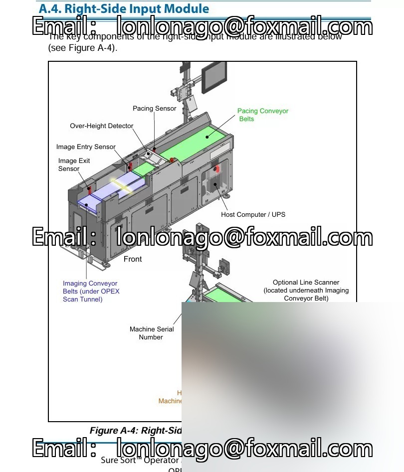
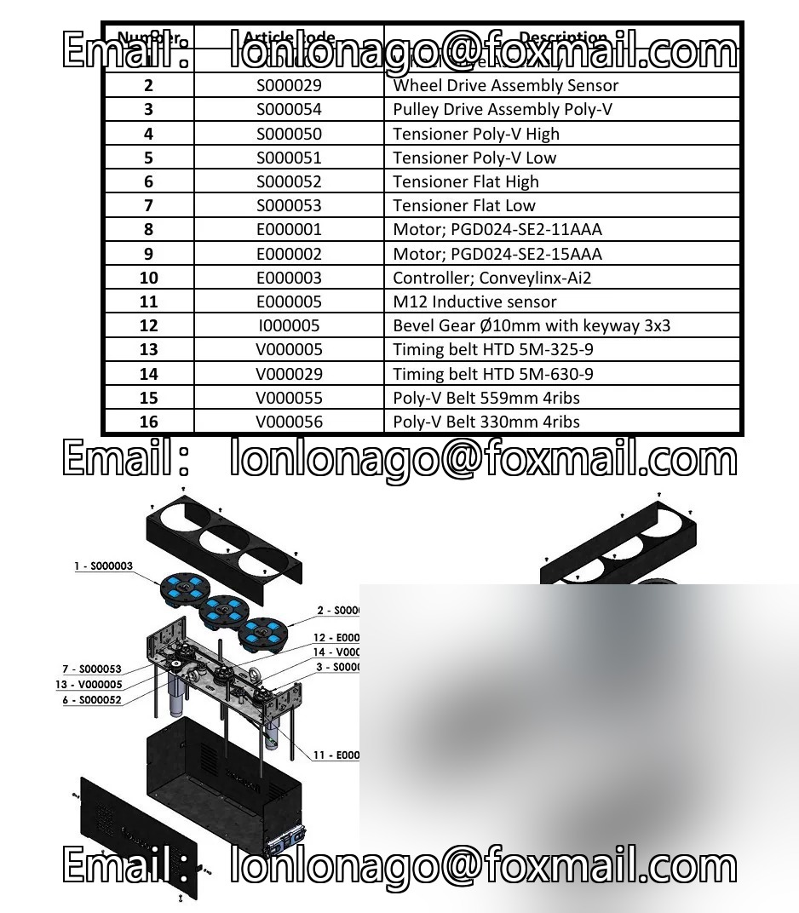
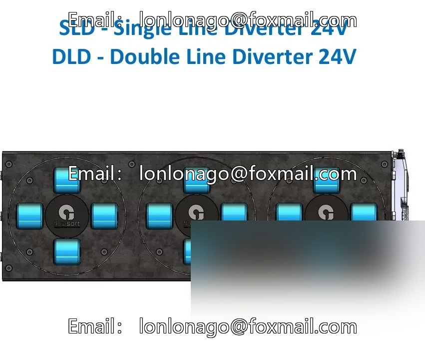
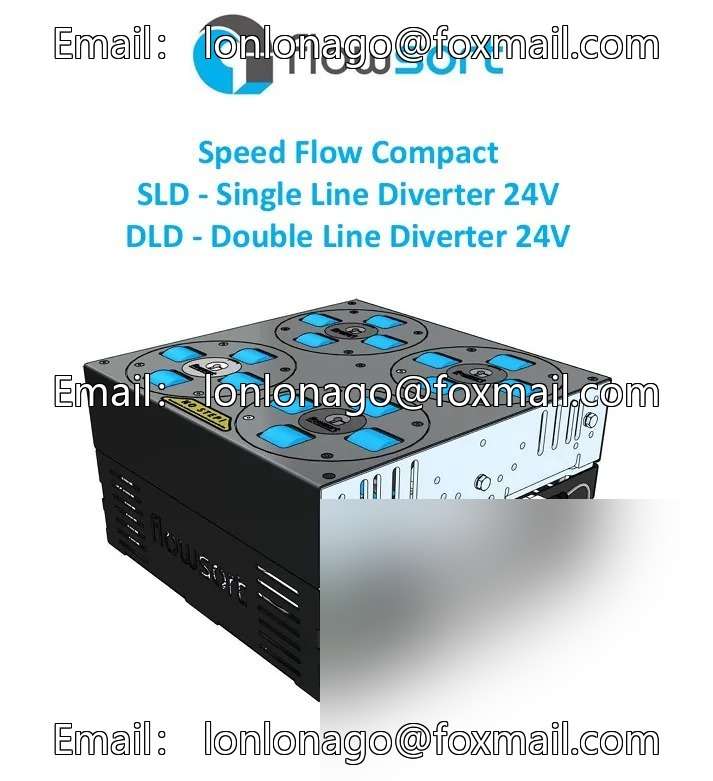
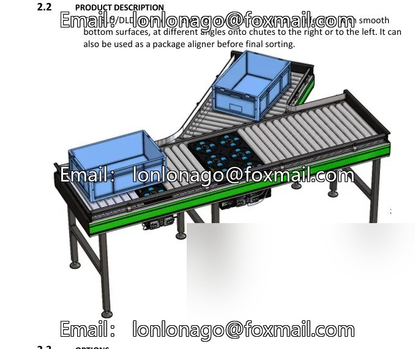
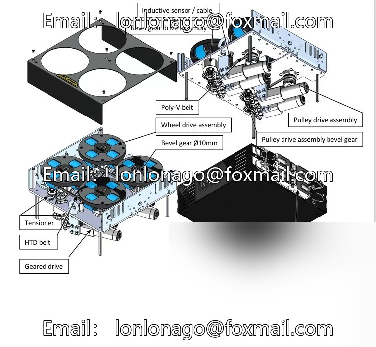
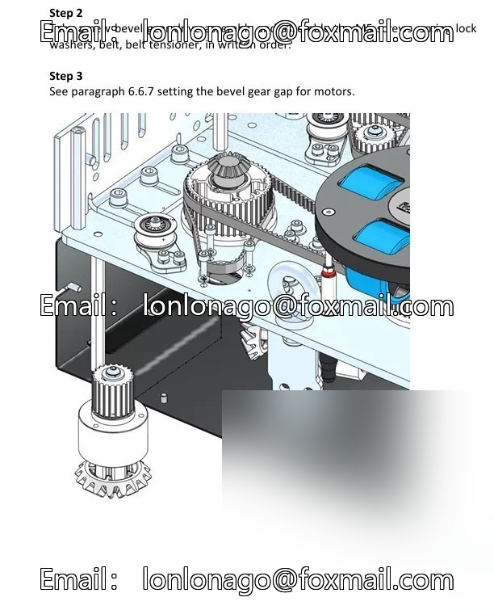

# The logistics transmission module manual and 3D drawings are very valuable reference for engineers of the transmission institution.

## Body

The logistics transfer module manual and 3D diagrams are of great reference value for engineers studying the transfer mechanism. The documentation contains a large number of details and references; through these materials, one can basically master this technology entirely! The documentation includes various manuals and reference 3D (STP format).

Taking it down and immediately sending the electronic original version! Images have file directory screenshots. Confirm before placing an order! Due to the replicability of electronic file materials, So the product cannot be returned after purchase! Thank you for understanding!

The manual and 3D images offer guidance for the logistics transport module, with details visible for the right-side input module, pacing sensors, conveyors, imaging equipment and the host computer/UPS.

<!-- AI_ENRICHED -->

## Images

## Payment

Here is a pay link on Stripe ( https://buy.stripe.com/3cs8yP7sY87d0vu9AB ). Please contact me lonlonago@foxmail.com after funding $89, and I will send you a complete data files , thank you!

